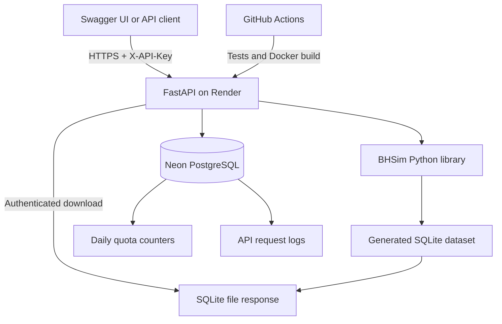

# BHSim API

**Generate, validate, and download synthetic behavioral health datasets through a REST API.**

[](https://www.python.org/)
[](https://fastapi.tiangolo.com/)
[](https://www.docker.com/)
[](https://github.com/rahulbyrapuneni/bhsim-api/actions/workflows/ci.yml)
[](https://bhsim-api-rb1997-ongole-q76d.onrender.com/health)

**Live API:** [Swagger / OpenAPI documentation](https://bhsim-api-rb1997-ongole-q76d.onrender.com/docs) · [Health check](https://bhsim-api-rb1997-ongole-q76d.onrender.com/health) · [Source code](https://github.com/rahulbyrapuneni/bhsim-api)

> **Project status:** API v0.3.0 is deployed and has been tested end-to-end (authentication → dataset generation → SQLite download). The companion [BHSim Web](https://github.com/rahulbyrapuneni/bhsim-web) interface is **in development**, not a finished public experience.

## Overview

BHSim API turns the open-source [BHSim Python library](https://github.com/rahulbyrapuneni/bhsim) into a callable service. It generates fictional, relational behavioral health data for analytics, application development, demonstrations, and integration testing—without requiring real patient records.

Users can request a dataset, retrieve its metadata, and download the resulting **SQLite `.db` file**. Generation results include validation and processing-time details.

**Intended use:** Synthetic test/demo data. Generated records are not real patient data, clinical evidence, or a substitute for a validated research dataset. Synthetic output should still be reviewed for suitability before any use.

## Features

- **Dataset generation:** configurable client counts, employee counts, history length, and reproducible random seed.
- **Relational SQLite output:** a downloadable database created using the BHSim generation engine.
- **Validation:** validates generated data and returns validation results.
- **API-key authentication:** authenticated dataset generation, metadata, and download endpoints using `X-API-Key`.
- **Daily quotas:** PostgreSQL-backed atomic counting, with a configured limit of **10 accepted generation attempts per API key per UTC day**.
- **Request logging:** PostgreSQL request records for generation outcomes, requested sizes, and processing metrics.
- **Concurrency control:** prevents overlapping generation jobs **within one API process** and returns a retryable busy response.
- **Temporary dataset cleanup:** eligible generated files expire after approximately one hour; cleanup runs opportunistically when new requests arrive.
- **Containerization and CI:** Docker image and GitHub Actions tests/build verification.

## Architecture



**Important:** SQLite datasets are generated on the API instance's temporary filesystem. Neon stores **quota counters and request logs**, not the generated SQLite datasets.

## Try the live API

1. Open [Swagger UI](https://bhsim-api-rb1997-ongole-q76d.onrender.com/docs).
2. Expand **Authorize** and enter the configured API key (do not prefix with `Bearer`).
3. Run **POST `/v1/datasets`** with a request body such as:

```json
{
  "clients": 100,
  "employees": 20,
  "history_months": 6,
  "seed": 42
}
```

4. Copy the returned `dataset_id`.
5. Call **GET `/v1/datasets/{dataset_id}`** to retrieve metadata, or **GET `/v1/datasets/{dataset_id}/download`** to download the SQLite database.

**Access note:** The API currently uses a shared, operator-managed key; visitors cannot self-register for credentials. A public browser interface is being developed separately. Do **not** commit a real API key, add it to screenshots, or embed it in browser JavaScript.

## API reference

Base URL:

```text
https://bhsim-api-rb1997-ongole-q76d.onrender.com
```

| Method | Path | Auth | Description |
| --- | --- | --- | --- |
| `GET` | `/health` | No | Service status and version. |
| `POST` | `/v1/datasets` | Yes | Generate, validate, and register a temporary dataset. |
| `GET` | `/v1/datasets/{dataset_id}` | Yes | Retrieve metadata for an existing generated dataset. |
| `GET` | `/v1/datasets/{dataset_id}/download` | Yes | Download generated SQLite database. |

### Request parameters

| Field | Type | Default | Accepted values | Meaning |
| --- | --- | ---: | --- | --- |
| `clients` | integer | `100` | 1–500 | Number of fictional clients. |
| `employees` | integer | `20` | 1–100 | Number of fictional employees. |
| `history_months` | integer | `12` | 1–12 | Months of generated history. |
| `seed` | integer | `42` | Integer | Seed for reproducible generation. |

The service applies these configuration limits at the API boundary. Resource usage increases with dataset size; not every maximum-sized combination has been benchmarked on the free instance.

### Example response (abbreviated)

A successful generation returns **HTTP 201** with fields similar to:

```json
{
  "dataset_id": "<generated-uuid>",
  "status": "completed",
  "clients_requested": 100,
  "employees_requested": 20,
  "database_format": "sqlite",
  "validation": { "valid": true },
  "performance": {
    "generation_seconds": 1.372,
    "validation_seconds": 0.061,
    "total_processing_seconds": 1.433
  }
}
```

*The ID is a placeholder and timings are illustrative of a measured configuration, not guaranteed performance. Additional validation fields may appear.*

### Example `curl` requests

Set `BHSIM_API_KEY` in your local environment first. Do not add real keys to shell history or source control.

```bash
curl -X POST \
  'https://bhsim-api-rb1997-ongole-q76d.onrender.com/v1/datasets' \
  -H 'Content-Type: application/json' \
  -H "X-API-Key: $BHSIM_API_KEY" \
  -d '{"clients":100,"employees":20,"history_months":6,"seed":42}'
```

Then download the returned dataset, substituting its ID:

```bash
curl -L \
  -H "X-API-Key: $BHSIM_API_KEY" \
  'https://bhsim-api-rb1997-ongole-q76d.onrender.com/v1/datasets/<dataset_id>/download' \
  -o bhsim-dataset.db
```

### Response codes

| Code | Meaning |
| --- | --- |
| `200` | Successful health, metadata, or download response. |
| `201` | Dataset generated and validated. |
| `401` | Missing or invalid API key. |
| `404` | Dataset not found, or no longer on the instance. |
| `422` | Invalid request or malformed identifier. |
| `429` | Daily generation allowance reached. |
| `500` | Dataset generation or validation failed. |
| `503` | Service busy or quota storage temporarily unavailable. |

## Run locally

### Requirements

- Python **3.14** (the version used in the current Docker build and CI setup)
- Git
- Access to a PostgreSQL database with the quota table and appropriate privileges to operate the quota service

```bash
git clone https://github.com/rahulbyrapuneni/bhsim-api.git
cd bhsim-api
python -m venv .venv
```

Activate the environment:

```powershell
# Windows PowerShell
.\.venv\Scripts\Activate.ps1
```

```bash
# macOS / Linux
source .venv/bin/activate
```

Install dependencies:

```bash
python -m pip install -r requirements.txt
```

Set the following **server-side** environment variables:

| Variable | Purpose |
| --- | --- |
| `BHSIM_API_KEY` | Secret required to call protected endpoints. |
| `DATABASE_URL` | PostgreSQL connection string for persistent quota tracking and request logs. |

Database prerequisites include a quota table (`api_daily_usage`) and a logging table (`api_request_logs`) with the schemas used by `quota.py` and `logging_service.py`. These tables are **not created automatically** by every API startup; provision them before enabling generation. The current service was provisioned manually in Neon.

Start the API:

```bash
python -m uvicorn main:app --reload --host 127.0.0.1 --port 8000
```

Browse `http://127.0.0.1:8000/docs`.

**Security:** Never commit `.env`, `.env.local`, private database URLs, or real API keys. Health checks are public; protected operations require credentials.

## Docker

```bash
docker build -t bhsim-api:0.3 .
```

Example local run on port 8000, with `BHSIM_API_KEY` and `DATABASE_URL` already set in the invoking shell:

```bash
docker run --rm -p 127.0.0.1:8000:8000 \
  -e BHSIM_API_KEY -e DATABASE_URL \
  bhsim-api:0.3
```

`--rm` removes the **container after it stops**; it does not delete the Docker image or source code. On Windows, use PowerShell line continuation or place the command on one line.

## Quotas, logs, and generated file lifecycle

**Quota behavior**

- Up to **10 accepted POST generation attempts per key per UTC day**.
- Requests that pass the quota check can consume an allowance even if generation subsequently fails.
- Metadata and download requests do not consume generation allowance.
- The quota uses an atomic PostgreSQL upsert for concurrent attempts.
- The deployed API currently uses one shared API key; quotas are not individual user accounts.

**Logging**

- `api_request_logs` stores timestamped generation events, HTTP status, requested counts, timing fields, and error category when applicable.
- API keys are not stored in plaintext: a SHA-256-derived identifier is used in quota/log records.
- The application attempts to record successful generations and selected error paths; logging is best-effort and should not be mistaken for a complete security audit trail.
- Because logs are written to the same Neon instance used for quota enforcement, database outages can also prevent logs from being written.

**Downloads and retention**

- Generated datasets are temporary SQLite files on the Render instance, **not persistent objects in Neon**.
- A one-hour age threshold is used for opportunistic cleanup during later generation requests; cleanup does not run on a dedicated schedule.
- Free-instance restarts, deployments, or spin-downs can remove files sooner. Download promptly after generating.
- Active-download protection is process-local; it is not a distributed storage or locking system.

## CI, testing, and deployment

GitHub Actions runs automated Python tests and verifies Docker build/startup. At the v0.3 milestone, **19 tests passed** in the project's test suite. Tests mock external quota/logging calls so normal CI runs don't need access to the live Neon database.

Run the test suite locally:

```bash
python -m pytest -q
```

The Dockerized service runs on **Render Free**; **Neon PostgreSQL** stores request quota counters and logging records. Health, authenticated dataset generation, Neon logging, and authenticated download were verified against the deployed v0.3 service.

### Measured Render performance

| Clients | Employees | History | Generation | Validation | Total processing |
| ---: | ---: | --- | ---: | ---: | ---: |
| 250 | 30 | 6 months | 7.301 s | 0.783 s | **8.084 s** |
| 500 | 40 | 6 months | 18.541 s | 2.395 s | **20.936 s** |

These are individual measurements on the free cloud instance, **not performance guarantees**, standardized load tests, or full network response times. Different employee counts mean the results are not an isolated client-count comparison. The maximum 500-client/12-month combination has not been validated here.

## Project structure

```text
bhsim-api/
├── main.py                 # FastAPI routes, authentication, generation workflow
├── quota.py                # PostgreSQL daily generation quota
├── logging_service.py      # Database-backed request logging
├── cleanup.py              # Temporary dataset retention and download tracking
├── requirements.txt        # Python dependencies
├── Dockerfile              # Container build and runtime
├── .dockerignore           # Files excluded from Docker build context
├── tests/                  # FastAPI, error, download, cleanup tests
└── .github/workflows/ci.yml # Automated tests and Docker smoke check
```

## Known limitations

- Free cloud hosting may introduce **cold starts**, CPU/memory constraints, and limited availability.
- Synchronous dataset generation is designed for **one active job per process**, not distributed worker scheduling.
- Request logging uses additional synchronous database operations, which may add latency.
- Authentication currently relies on a shared key, not per-user accounts or individual access controls.
- Temporary on-instance SQLite storage is **not durable** and is not suitable for long-lived datasets.
- The API is a portfolio/open-source demonstration; it has not been independently audited for production security, compliance, or high-availability operations.

## Related projects

- [BHSim Python library](https://github.com/rahulbyrapuneni/bhsim) — the open-source synthetic data generation engine; installable as `bhsim` from PyPI.
- [BHSim Web](https://github.com/rahulbyrapuneni/bhsim-web) — an in-progress React/Vite frontend with a server-side proxy; **not yet publicly launched**.

## Maintainer

**Rahul Byrapuneni** · [GitHub](https://github.com/rahulbyrapuneni)

Feedback, issues, and contributions are welcome through the repository's GitHub Issues interface.

## License

See the repository's license file if one is present. **Do not assume that the BHSim Python library's license automatically applies to this API repository.** Add an explicit `LICENSE` file here if you intend to publish it under a specific open-source license.
